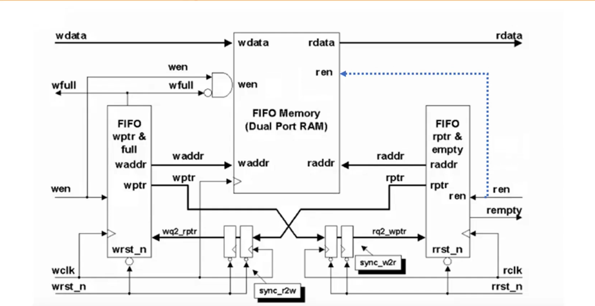

# Asynchronous FIFO in Verilog

A dual-clock (asynchronous) FIFO written in Verilog for safe data transfer between two independent clock domains. It uses Gray-coded read/write pointers, 2-flip-flop synchronizers for clock domain crossing (CDC), registered full/empty flags, and an added **occupancy count** with a programmable **almost-full** flag.

The architecture follows the classic Clifford Cummings style asynchronous FIFO.

---

## Table of contents

- [Features](#features)
- [Why an asynchronous FIFO?](#why-an-asynchronous-fifo)
- [Architecture](#architecture)
- [File structure](#file-structure)
- [Parameters](#parameters)
- [Top-level ports](#top-level-ports)
- [Module descriptions](#module-descriptions)
- [Key design concepts](#key-design-concepts)
- [Simulation](#simulation)
- [Known behaviour and notes](#known-behaviour-and-notes)
- [Future improvements](#future-improvements)
- [References](#references)

---

## Features

- Independent write clock (`wclk`) and read clock (`rclk`)
- Parameterized data width and depth
- Gray-coded pointers so only one bit changes per increment (CDC-safe)
- 2-FF synchronizers in both directions (`sync_r2w`, `sync_w2r`)
- Registered, glitch-free `wfull` and `rempty` flags
- Overflow and underflow protection (writes blocked when full, reads blocked when empty)
- Extra wrap bit on each pointer to distinguish full from empty
- **Added:** write-side occupancy `count`
- **Added:** registered `almost_full` flag with a configurable threshold (`AF_thresh`)
- Self-contained Verilog testbench

---

## Why an asynchronous FIFO?

When data moves between two blocks running on unrelated clocks, a multi-bit value sampled in the other domain can be caught mid-transition and read as a value that never existed. Flops can also go metastable.

An asynchronous FIFO solves this by:

1. Storing data in a dual-port RAM, written in one clock domain and read in the other.
2. Passing only the **pointers** across domains, never the data.
3. Encoding the pointers in **Gray code**, so at most one bit changes at a time. A synchronizer can then only ever see the old value or the new value.

---

## Architecture



| Block | Clock domain | Purpose |
|---|---|---|
| `fifo_mem` | `wclk` (write) | Dual-port RAM storing the data |
| `wptr_full` | `wclk` | Write pointer, full flag, count, almost_full |
| `rptr_empty` | `rclk` | Read pointer, empty flag |
| `sync_r2w` | `wclk` | Brings Gray read pointer into the write domain |
| `sync_w2r` | `rclk` | Brings Gray write pointer into the read domain |

---

## File structure

```
├── src/
│   ├── FIFO_top.v        # Top-level module, connects all blocks
│   ├── fifo_mem.v        # Dual-port RAM
│   ├── wptr_full.v       # Write pointer, full, count, almost_full
│   ├── rptr_empty.v      # Read pointer, empty
│   └── synchronizer.v    # 2-FF pointer synchronizer (instantiated twice)
├── sim/
│   └── FIFO_tb.v         # Testbench
├── docs/
│   └── block_diagram.png
└── README.md
```

---

## Parameters

| Parameter | Default | Description |
|---|---|---|
| `data_size` | `8` | Width of each data word in bits |
| `addr_size` | `4` | Pointer width **including the wrap bit**. Memory address = `addr_size-1` bits |
| `AF_thresh` | `6` | `almost_full` asserts when `count >= AF_thresh` |

With the defaults, `addr_size = 4` gives a 3-bit memory address plus 1 wrap bit, so the FIFO is **8 words deep**.

```
FIFO depth = 2^(addr_size - 1)
```

> `addr_size` must be at least 3, because the full-flag logic slices `[addr_size-3:0]`.

---

## Top-level ports

`FIFO_top`

| Port | Direction | Width | Domain | Description |
|---|---|---|---|---|
| `wdata` | input | `data_size` | wclk | Data to write |
| `wen` | input | 1 | wclk | Write enable |
| `wclk` | input | 1 | — | Write clock |
| `wrst_n` | input | 1 | wclk | Active-low asynchronous reset, write side |
| `ren` | input | 1 | rclk | Read enable |
| `rclk` | input | 1 | — | Read clock |
| `rrst_n` | input | 1 | rclk | Active-low asynchronous reset, read side |
| `rdata` | output | `data_size` | rclk | Data read from the FIFO |
| `wfull` | output | 1 | wclk | FIFO full flag |
| `rempty` | output | 1 | rclk | FIFO empty flag |
| `count` | output | `addr_size` | wclk | Number of words in the FIFO (write-side view) |
| `almost_full` | output | 1 | wclk | High when `count >= AF_thresh` |

### Internal wires in `FIFO_top`

| Wire | Width | Description |
|---|---|---|
| `waddr` | `addr_size-1` | Binary write address into memory (wrap bit dropped) |
| `raddr` | `addr_size-1` | Binary read address into memory (wrap bit dropped) |
| `wptr` | `addr_size` | Gray-coded write pointer (write domain) |
| `rptr` | `addr_size` | Gray-coded read pointer (read domain) |
| `wq2_rptr` | `addr_size` | Read pointer synchronized into the write domain |
| `rq2_wptr` | `addr_size` | Write pointer synchronized into the read domain |

Naming convention: `wq2_rptr` = "**w**rite-domain, **q**ualified after **2** flops, **r**ead **ptr**". `rq2_wptr` is the mirror.

---

## Module descriptions

### 1. `fifo_mem` — dual-port RAM

Stores the data words. Written on `wclk`, read asynchronously.

```verilog
localparam depth = 1 << (addr_size-1);      // 8 locations
reg [data_size-1:0] memory [0:depth-1];

assign rdata = memory[raddr];               // combinational read

always @(posedge wclk)
    if (wen && !wfull) memory[waddr] <= wdata;
```

| Signal | Description |
|---|---|
| `memory` | Storage array, `depth` words of `data_size` bits |
| `wen && !wfull` | The AND gate in the block diagram; blocks writes when full |

- The read is combinational, so `rdata` always shows `memory[raddr]`. This gives first-word-fall-through behaviour, and the dotted `ren` line to the RAM in the diagram is not needed.
- On FPGA this infers distributed (LUT) RAM.

---

### 2. `wptr_full` — write pointer, full flag, count, almost_full

Runs on `wclk`. Keeps the write pointer in both binary (to address memory) and Gray (to cross domains), and decides when the FIFO is full.

| Variable | Type | Width | Description |
|---|---|---|---|
| `addr_b` | reg | `addr_size` | Current binary write pointer (MSB = wrap bit) |
| `next_addr_b` | wire | `addr_size` | Next binary pointer: `addr_b + (wen && !wfull)` |
| `next_addr_g` | wire | `addr_size` | Next pointer in Gray: `next_addr_b ^ (next_addr_b >> 1)` |
| `wptr` | reg | `addr_size` | Registered Gray write pointer, sent to `sync_w2r` |
| `waddr` | wire | `addr_size-1` | `addr_b[addr_size-2:0]`, memory address |
| `wfull_val` | wire | 1 | Combinational full condition |
| `wfull` | reg | 1 | Registered full flag |
| `wq2_rptr_b` | reg | `addr_size` | Synced read pointer converted from Gray to binary |
| `count_val` | wire | `addr_size` | `next_addr_b - wq2_rptr_b` |
| `count` | reg | `addr_size` | Registered occupancy |
| `almost_full` | reg | 1 | Registered `count_val >= AF_thresh` |

**Full condition.** The FIFO is full when the write pointer has wrapped once more than the read pointer. In Gray code this means the **top two bits are inverted** and the rest are equal:

```verilog
assign wfull_val = (next_addr_g ==
    {~wq2_rptr[addr_size-1:addr_size-2], wq2_rptr[addr_size-3:0]});
```

**Gray to binary.** An XOR chain from the MSB down:

```verilog
wq2_rptr_b[addr_size-1] = wq2_rptr[addr_size-1];
for (i = addr_size-2; i >= 0; i = i - 1)
    wq2_rptr_b[i] = wq2_rptr_b[i+1] ^ wq2_rptr[i];
```

**Count.** Modulo subtraction of the two binary pointers. The wrap bit makes this correct across wraparound:

```verilog
assign count_val = next_addr_b - wq2_rptr_b;
```

---

### 3. `rptr_empty` — read pointer and empty flag

Runs on `rclk`. Mirror image of `wptr_full`.

| Variable | Type | Width | Description |
|---|---|---|---|
| `addr_b` | reg | `addr_size` | Current binary read pointer (MSB = wrap bit) |
| `next_addr_b` | wire | `addr_size` | `addr_b + (ren && !rempty)` |
| `next_addr_g` | wire | `addr_size` | Next pointer in Gray |
| `rptr` | reg | `addr_size` | Registered Gray read pointer, sent to `sync_r2w` |
| `raddr` | wire | `addr_size-1` | `addr_b[addr_size-2:0]`, memory address |
| `rempty_val` | wire | 1 | Combinational empty condition |
| `rempty` | reg | 1 | Registered empty flag, resets to 1 |

**Empty condition.** The FIFO is empty when the next read pointer equals the synchronized write pointer:

```verilog
assign rempty_val = (next_addr_g == rq2_wptr);
```

---

### 4. `synchronizer` — 2-FF pointer synchronizer

Instantiated twice:

| Instance | Clock | Reset | Input | Output |
|---|---|---|---|---|
| `sync_r2w` | `wclk` | `wrst_n` | `rptr` | `wq2_rptr` |
| `sync_w2r` | `rclk` | `rrst_n` | `wptr` | `rq2_wptr` |

| Port / variable | Description |
|---|---|
| `clk` | Destination clock |
| `rst` | Destination-domain active-low reset |
| `ptr` | Gray pointer from the source domain |
| `temp` | First flop stage (may go metastable) |
| `m2m_ptr` | Second flop stage, synchronized output |

Each synchronizer is reset by its **destination** domain's reset.

---

### 5. `FIFO_top` — top level

Instantiates and connects:

| Instance name | Module |
|---|---|
| `RAM` | `fifo_mem` |
| `sync_r2w` | `synchronizer` |
| `sync_w2r` | `synchronizer` |
| `rptrempty` | `rptr_empty` |
| `fptrfull` | `wptr_full` |

---

## Key design concepts

### Gray-coded pointers
Binary counters can flip several bits at once (for example `011 → 100`). If sampled mid-transition in another clock domain, the result could be any mix. Gray code changes only one bit per increment, so the synchronizer always captures either the old or the new pointer.

| Binary | Gray |
|---|---|
| 0000 | 0000 |
| 0001 | 0001 |
| 0010 | 0011 |
| 0011 | 0010 |
| 0100 | 0110 |
| 0101 | 0111 |
| 0110 | 0101 |
| 0111 | 0100 |
| 1000 | 1100 |

### Wrap bit
Pointers carry one extra MSB beyond what the memory needs. When both pointers are equal, the FIFO is empty. When the address bits match but the wrap bits differ, the writer has lapped the reader, so the FIFO is full.

### Registered pointers before crossing
`wptr` and `rptr` are driven straight from flip-flops, not from combinational logic. A combinational path could glitch, which would break the one-bit-change guarantee.

### Pessimistic flags
Synchronized pointers are 2–3 cycles old. As a result:
- `wfull` may stay high a few cycles after space frees up.
- `rempty` may stay high a few cycles after data arrives.
- `count` may over-estimate occupancy.

All of these are in the safe direction: the FIFO never overflows or underflows.

---

## Simulation

Testbench: `sim/FIFO_tb.v`

| Setting | Value |
|---|---|
| `wclk` period | 10 ns |
| `rclk` period | 20 ns |
| Reset release | 20 ns |
| Data | `$random(seed)` |

### Test 1 — simultaneous write and read
`ren = 1`, 10 writes. Expected:
- Data comes out in the same order it went in.
- `rempty` drops a few `rclk` cycles after the first write (synchronizer latency).
- `count` rises, then oscillates while reads and writes run together, then falls to 0 once writes stop.
- Pointers wrap correctly after 8 writes.

### Test 2 — full condition
`ren = 0`, 11 writes, then drain. Expected:
- `almost_full` goes high when `count` reaches 6.
- `wfull` goes high when `count` reaches 8.
- The last 3 writes are blocked, so `count` stays at 8.
- After `ren = 1`, the FIFO drains and `rempty` goes high.

### Running

**Vivado**
1. Add all files in `src/` as design sources and `sim/FIFO_tb.v` as a simulation source.
2. Set `FIFO_tb` as the simulation top.
3. Run Behavioral Simulation and add `count`, `almost_full`, `wfull` and `rempty` to the waveform.

**Icarus Verilog**
```bash
iverilog -o fifo_sim src/*.v sim/FIFO_tb.v
vvp fifo_sim
```

---

## Known behaviour and notes

- `rdata` is only valid while `rempty = 0`. Because the read is combinational, `rdata` keeps showing `memory[raddr]` after the FIFO empties, which may be stale data from an earlier pass.
- `count` is the **write-side** view and is pessimistic (may read high).
- Resets `wrst_n` and `rrst_n` are applied directly; there is no reset synchronizer yet.

---

## References

- Clifford E. Cummings, *Simulation and Synthesis Techniques for Asynchronous FIFO Design*, SNUG 2002.

---

## Author

**Anik Das** — Electronics and Tele-Communication Engineering, Jadavpur University
[LinkedIn](https://linkedin.com/in/anikdasece)
